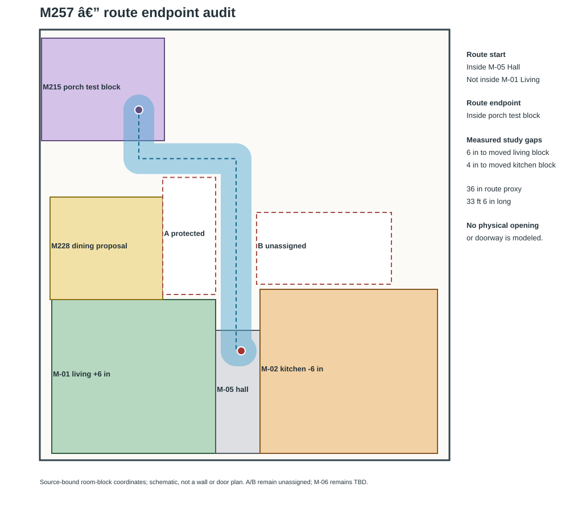

# M257 — Living-to-porch route endpoint audit

**Status:** reproducible route-endpoint diagnosis; no doorway or layout selected.

## Finding

`Tools/audit_m257_living_to_porch_route_endpoints.ps1` transforms M243's six-inch route-start variant into selected-D plan coordinates and checks its endpoints against the source room blocks and M215 porch test block. Two Windows PowerShell 5.1 runs pass **13/13** and reproduce report, checks and SVG byte-for-byte:

| Artifact | SHA256 |
|---|---|
| Report | `b6cce5a46df3344a859032c8be5d8af6d4f71fb812255ff3643c69baa24da905` |
| Checks | `f7a07aa0d526435771f236db7babcfdd2ca34ea20c1cb2553f62c6b260741d31` |
| SVG | `f8588918fd0803b2ddc13bedfb40dc7331f38338ef99289ccf6e0b63956d59ad` |
| Generator | `db888bd1ac0e3d13e9a5994a62c9d18f74a36c307dcb3aecf423c2b3b535393c` |

The 33 ft 6 in / 36 in corridor starts at `(19.6667, 10.6667)` ft inside the M-05 hall block and ends at `(9.6667, 34.1667)` ft inside the M215 porch test block. The start cap is 12 in from M-01 and 4 in from the shifted M-02; the route's closest swept edge is 6 in from M-01. This proves neither a door nor a connection to living. The corridor is a continuous **hall-to-porch room-block proxy**, not a verified living-to-porch path.

The SVG makes the gap and route endpoints explicit:



## Reproduce

From the repository root in Windows PowerShell 5.1, first generate M256's pinned report, then run M257 twice:

```powershell
powershell.exe -NoProfile -ExecutionPolicy Bypass -File Tools/verify_m256_living_kitchen_route_integration.ps1 -OutputDirectory .local/revalidation/M256-integrated-room-route-run7
powershell.exe -NoProfile -ExecutionPolicy Bypass -File Tools/audit_m257_living_to_porch_route_endpoints.ps1 -OutputDirectory .local/revalidation/M257-endpoint-run2
powershell.exe -NoProfile -ExecutionPolicy Bypass -File Tools/audit_m257_living_to_porch_route_endpoints.ps1 -OutputDirectory .local/revalidation/M257-endpoint-run3
```

M257 pins selected-D, M215, M228, M243 and the M256 report. The SVG is assembled from their published room-block and route coordinates; it does not represent walls or openings.

## Next gate and limits

The owner preference for a fully open living/kitchen connection remains unresolved in the room-block topology; the hall is a separate block. The M215 route begins in that hall, not in living. A design that connects living to this route needs documented opening/adjacency geometry and a new route check. The user has been asked whether a separate M-05 topology sensitivity should be studied.

No wall faces, door leaf/swing, thresholds, finish build-up, site/grade, occupied movement, services, IFC or native Revit geometry are modeled. The inherited 36 in route width is an analysis proxy, not a code or accessibility determination. M-06/A/B remain unassigned; selected-D, retained RVT/IFC and RFAs were not changed. No structural-safety, code-compliance, professional-certification, permit-approval, or construction-readiness conclusion follows.
